<div align="center">

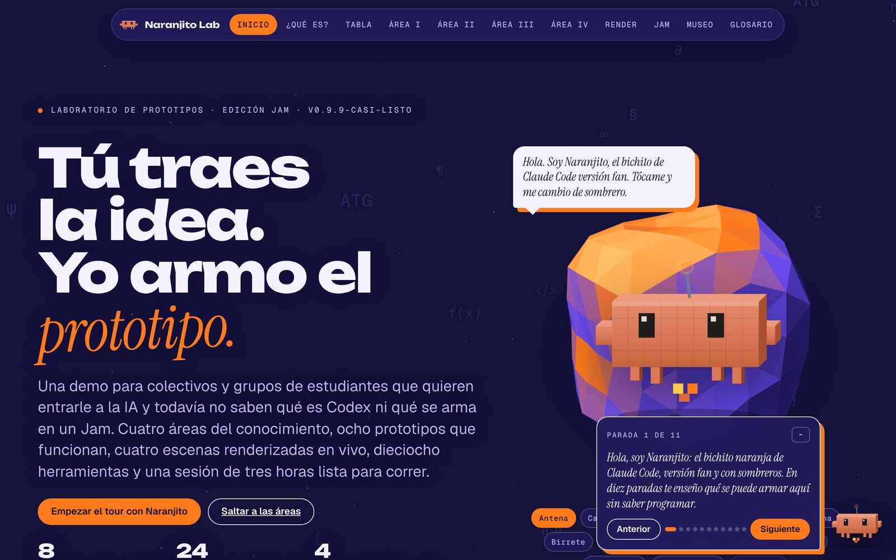

# Naranjito Lab

**Una demo interactiva para colectivos y grupos de estudiantes que quieren entrarle a la IA y todavía no saben qué es Codex ni qué se arma en un Jam.**

Ocho prototipos que funcionan · cuatro escenas renderizadas en vivo · un estudio 3D de autos y casas · un museo de 24 siglos · cero líneas que tengas que escribir

`HTML` · `CSS` · `JavaScript` · `Canvas 2D` · `WebGL` · `Web Audio` · `three.js` · sin frameworks, sin backend

</div>

---

## Sobre este repo

> VISUAL THINGS AND DYNAMIC TOUR LANDSCAPE ABOUT ALL THE NEWS THAT BRINGS TO YOU CLAUDE CODE; EXPLAIN FOR ALL THE TEAM MEMBERS WHAT THE AI LAB HAS NEW AND FEEL FREE TO INTEGRATE MORE DEVELOPMENT MODULES AND ARCHITECTURE OF YOUR CREATIVITY AND AUTHORSHIP

Naranjito Lab es el primer módulo de este laboratorio: una vuelta guiada por lo que hoy se puede construir con Claude Code. Cada módulo nuevo puede vivir en su propia sección de la página o en su propia carpeta.

## Qué es

Una sola página web, hecha en una sesión con [Claude Code](https://claude.com/claude-code), que sirve para dar una plática o correr un taller. Te guía **Naranjito**, un robotcito naranja de pixeles que cambia de sombrero según la sección. Explica qué hace un agente de IA, enseña prototipos reales de las cuatro áreas del conocimiento y trae todo lo necesario para correr un Jam de tres horas.

Cada fondo, gráfica, simulación y escena es código que se dibuja en tu navegador. No hay fotos ni video.

## Recorrido

### 1. ¿Chat, agente o qué?
Una terminal que se escribe sola muestra cómo un agente pasa de un pedido a un link publicado. Un control de autonomía va de *autocompletar* a *equipo de agentes*.

### 2. La tabla periódica de lo posible
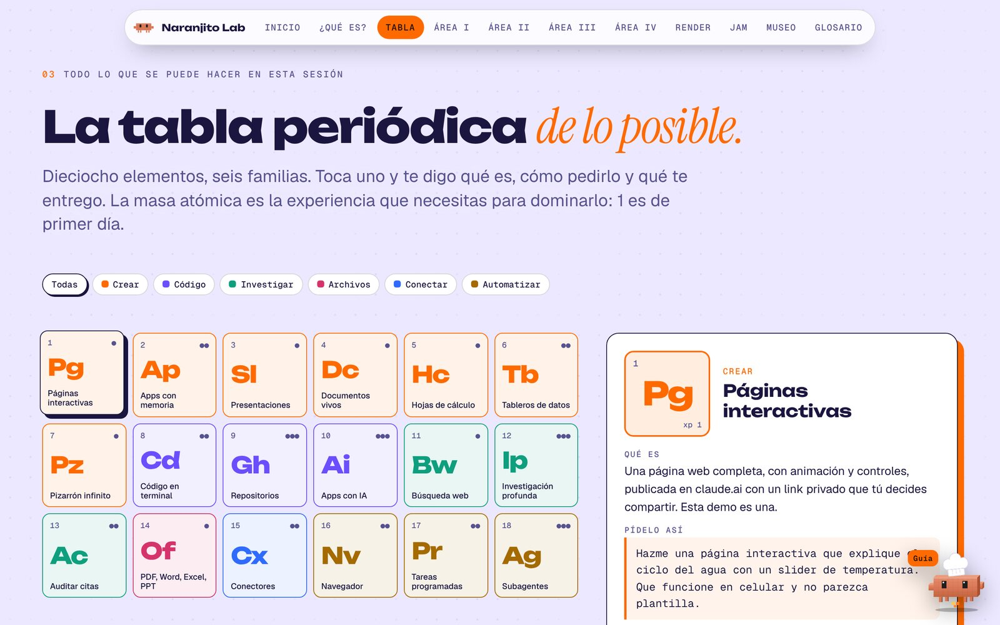

Dieciocho cosas que se pueden hacer con un agente, en seis familias. Cada una trae qué es, un prompt para copiar y lo que entrega.

### 3. Las cuatro áreas del conocimiento

| Área | Prototipos que funcionan |
|---|---|
| **I · Físico-Matemáticas e Ingenierías** | Péndulo doble caótico integrado con RK4 · Dibujo reconstruido con epiciclos de Fourier |
| **II · Biológicas, Químicas y de la Salud** | Modelo epidémico SIR con vacunación · Traductor de ADN a proteína con mutaciones |
| **III · Ciencias Sociales** | D'Hondt, Sainte-Laguë y Hare con hemiciclo, coaliciones e índice de Gallagher · Torneo de Axelrod del dilema del prisionero |
| **IV · Humanidades y Artes** | Caja de ritmos pentatónica con Web Audio · Ley de Zipf aplicada a Cervantes y Sor Juana |

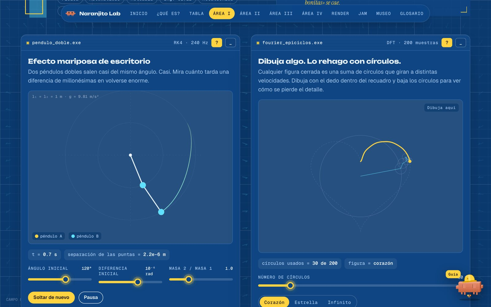 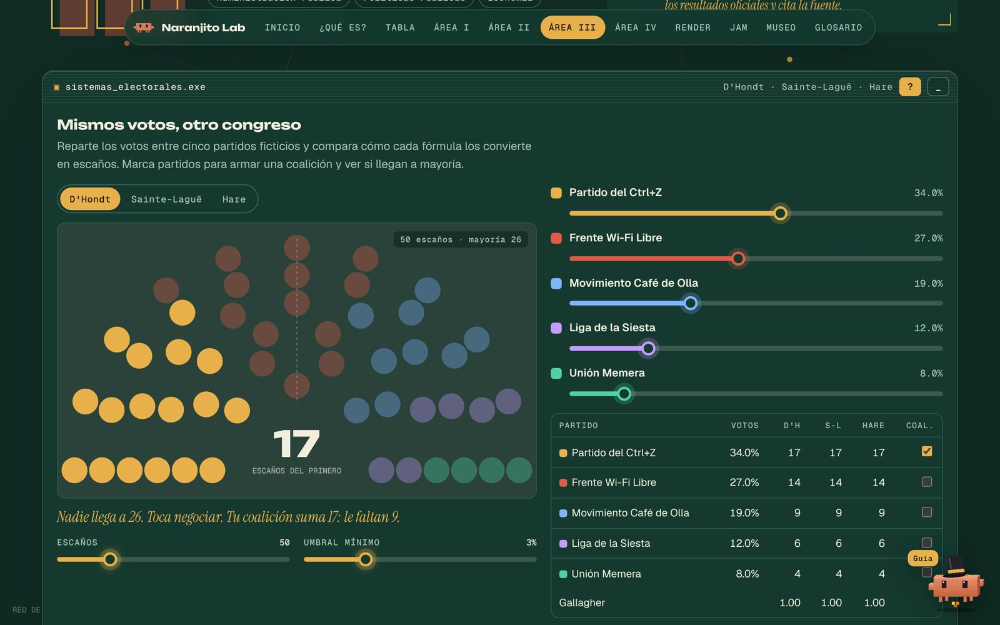

Cada ventana tiene un botón **«?»** que enseña el prompt que la arma, y cada área trae seis ideas más para un Jam, con su prompt listo para copiar.

### 4. Agua, tierra, fuego y aire: render en tiempo real

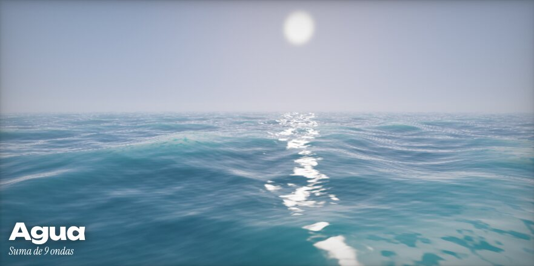 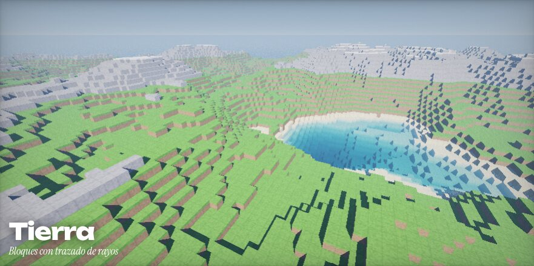
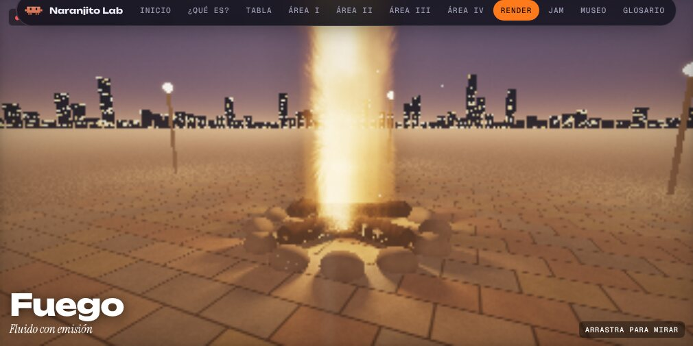 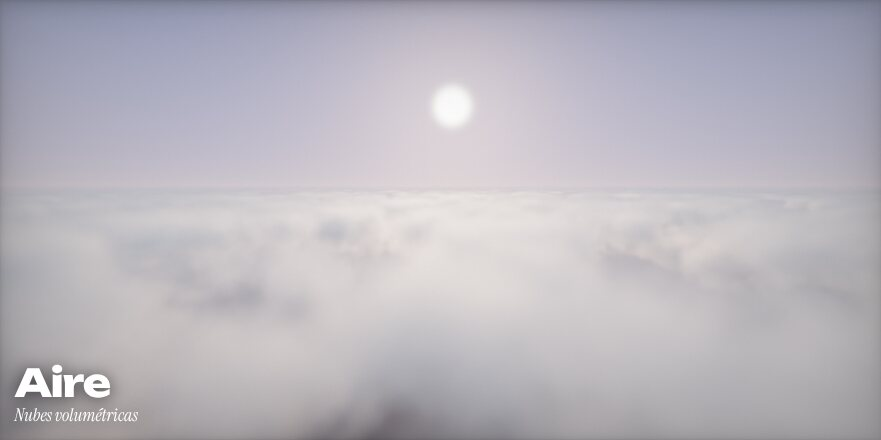

Cuatro shaders de WebGL que tu tarjeta gráfica calcula rayo por rayo:

| Escena | Cómo se modela |
|---|---|
| **Agua** | Suma de 9 ondas con la relación de dispersión ω = √(g·k), reflejo de Fresnel y espuma en las crestas |
| **Tierra** | Mundo de bloques recorrido con el algoritmo DDA de Amanatides y Woo, sombras con un segundo rayo y oclusión ambiental |
| **Fuego** | Fluido simulado en la GPU (Navier-Stokes en una rejilla de 128 × 256: advección, flotación, vorticidad y presión) con emisión de cuerpo negro, en una plaza de cantera frente a una ciudad con ventanas ámbar |
| **Aire** | Nubes volumétricas con atenuación de Beer-Lambert y dispersión de Henyey-Greenstein |

Arrastras para mirar alrededor, mueves el sol y eliges la calidad: **Modo papa**, **Auto** o **5090 en max**. Un contador de FPS te dice cuánto aguanta tu equipo.

**El fuego tiene química y se puede reventar.** Cinco químicas de flama, como en la prueba de flama del laboratorio: leña, gas (azul por los radicales CH y C₂), cobre (verde), estroncio (rojo carmín) y arcoíris. Si sostienes la intensidad alta o la mueves muy rápido, la presión revienta la hoguera: onda expansiva, los seis faroles truenan uno por uno y sueltan cristales, la ciudad se apaga en ola y solo queda el fuego creciendo en la oscuridad con sus sombras. Todo con sonido sintetizado y un botón para restaurar las luces.

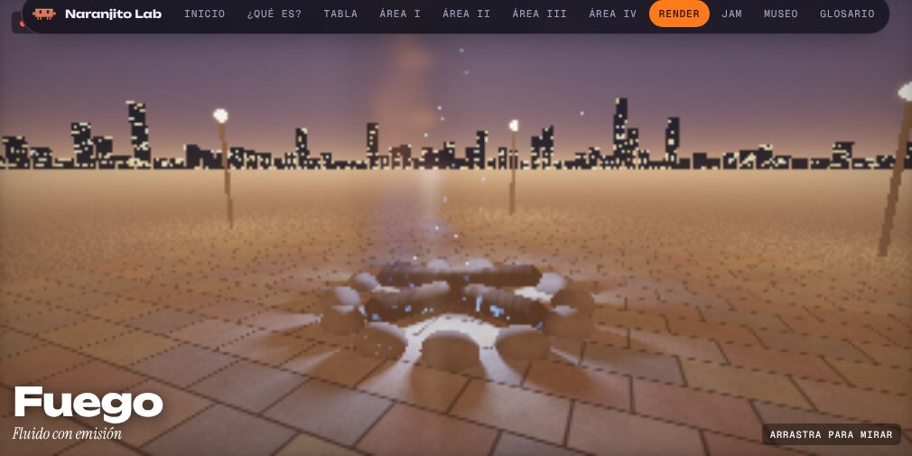 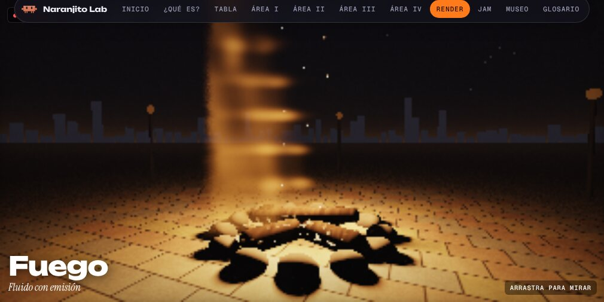

> Las capturas se tomaron con un navegador sin tarjeta gráfica. En una GPU real se ven igual y se mueven con fluidez.

### 5. Estudio de arquitectura viva 3D

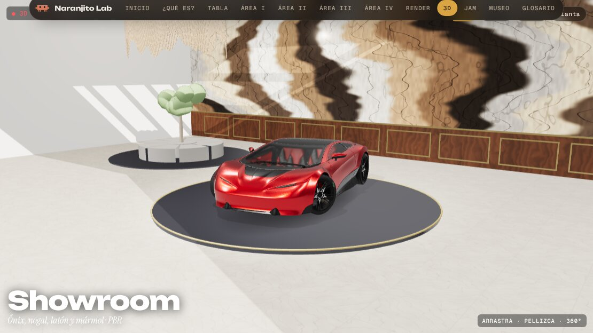

Un motor 3D profesional, [three.js](https://threejs.org), corriendo en el navegador con materiales físicos (PBR), sombras y reflejos.

- **Showroom:** muro de ónix veteado, lambrín de nogal con marcos de latón, tragaluz con vigas de acero por donde entra el sol, candil de más de mil cadenas, sillón redondo sobre mármol negro y el auto en una tornamesa.
- **Villa y yate:** casa frente al mar con planta baja de cristal, alberca infinita, palmeras, muelle de teca y un yate de 20 metros. El cielo es un modelo físico de dispersión y el agua refleja la escena en tiempo real.
- **El auto** es un modelo glTF real, con pintura de capa transparente, cristales y faros emisivos. Tiene 3 variantes de fábrica y 3 colores propios.
- **Controles:** hora del día de 6:00 a 22:00 (sombras, atardecer y noche con todo encendido), faros y calaveras, giro 360°, **corte de sección** y **vista de plano tipo AutoCAD**, más cámaras predefinidas.

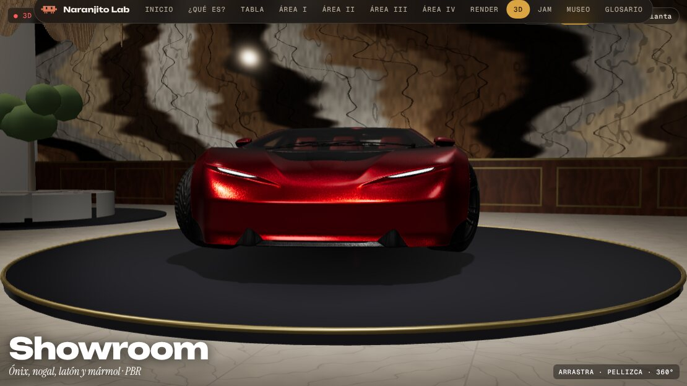 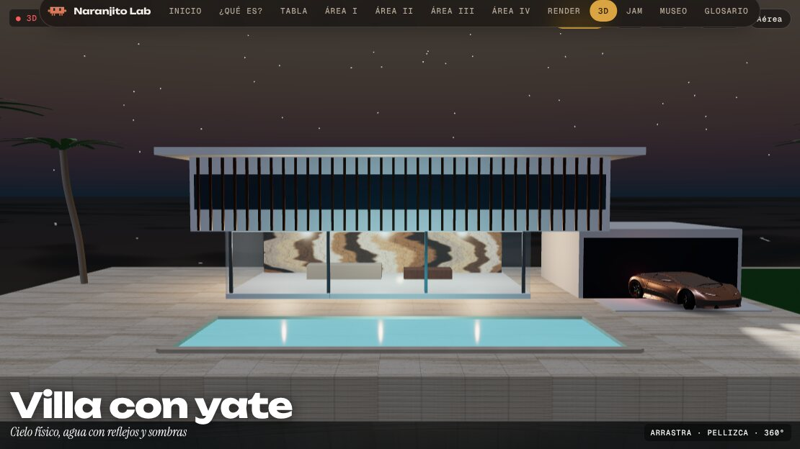
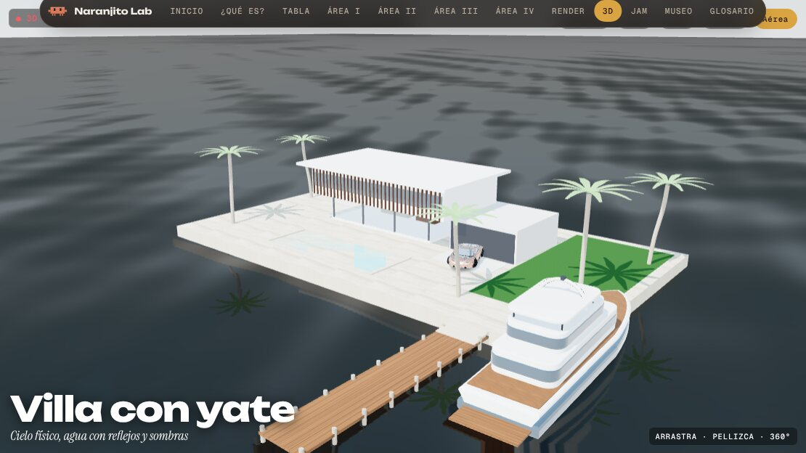 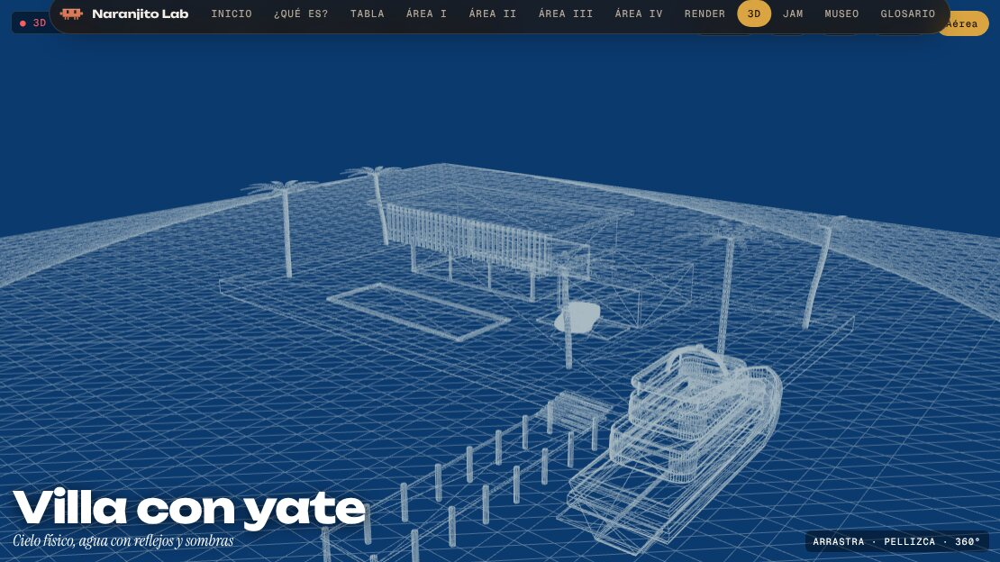

### 6. Kit para el Jam
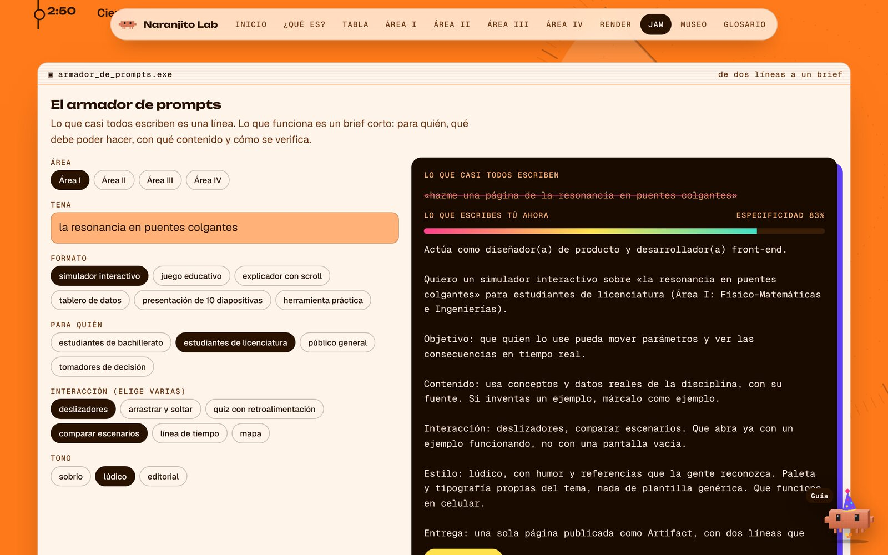

- Un programa de tres horas, bloque por bloque
- Un armador que convierte «hazme una página de X» en un brief completo
- Una ruleta de retos
- Un cronómetro de sprint de 10 minutos

### 7. Museo de la máquina que piensa

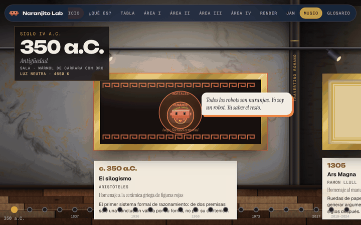

Una línea del tiempo que avanza mientras bajas. El año corre en una placa de pared y Naranjito camina por la sala, se mete a cada cuadro a jugar con la obra, se pone lentes industriales en la Revolución industrial y **se desmaya frente a la computadora cuántica**.

- **Salas con paredes de verdad.** Diez materiales generados en la tarjeta gráfica con ruido fractal y deformación de dominio: mármol de Carrara con vetas de oro, travertino, nogal, tablones, Bardiglio, Verde Alpi, Nero Marquina, Breccia rosa, Rosso Alicante y Giallo Siena. Cada sala tiene su moldura y el piso es de duela de madera.
- **Luces de riel.** Cada cuadro tiene su lámpara, que se balancea con la inercia del scroll. Mientras te quedas frente a una obra, la luz recorre la temperatura de color de fría (6500 K) a neutra, amarilla, ámbar y cálida (2700 K). La placa muestra los Kelvin en vivo.

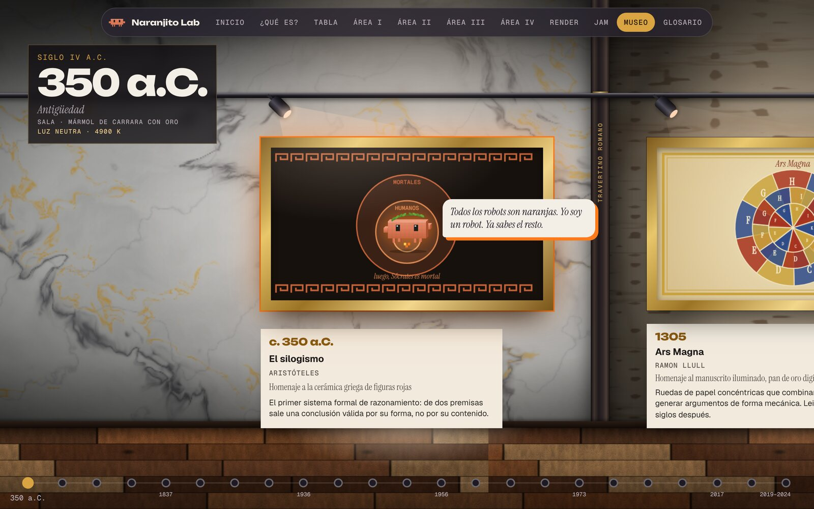 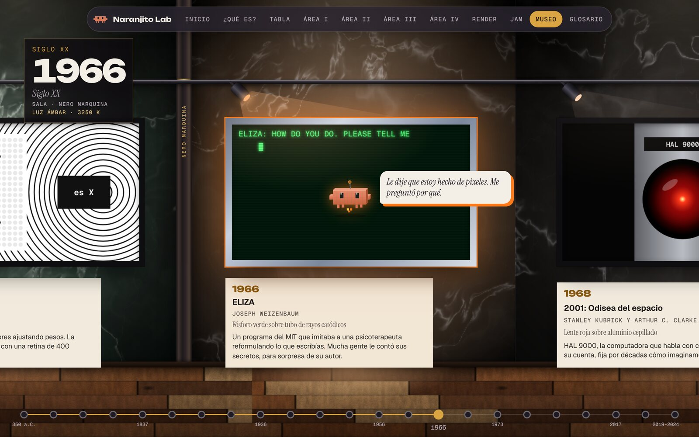

| Año | Obra | Año | Obra |
|---|---|---|---|
| c. 350 a.C. | Aristóteles · El silogismo | 1958 | Frank Rosenblatt · El perceptrón |
| 1305 | Ramon Llull · Ars Magna | 1966 | Joseph Weizenbaum · ELIZA |
| 1687 | Isaac Newton · El cálculo | 1968 | Kubrick y Clarke · *2001: Odisea del espacio* |
| 1703 | Gottfried W. Leibniz · Aritmética binaria | 1973 | Harold Cohen · AARON |
| 1837 | Charles Babbage · La Máquina Analítica | 1989 | Yann LeCun · Redes convolucionales |
| 1843 | Ada Lovelace · Nota G | 1989–2009 | John L. Pollock · OSCAR |
| 1854 | George Boole · Las leyes del pensamiento | 1995 | David Chalmers · El problema difícil |
| 1890 | Herman Hollerith · La tabuladora | 2017 | Vaswani y equipo · El Transformer |
| 1936 | Alan Turing · La máquina de Turing | 2023 | Anthropic · Claude y Claude Code |
| 1943 | McCulloch y Pitts · La neurona artificial | 2019–2024 | La computadora cuántica |
| 1948 | Claude Shannon · Teoría de la información | | |
| 1950 | Alan Turing · El juego de la imitación | | |
| 1956 | El taller de Dartmouth | | |

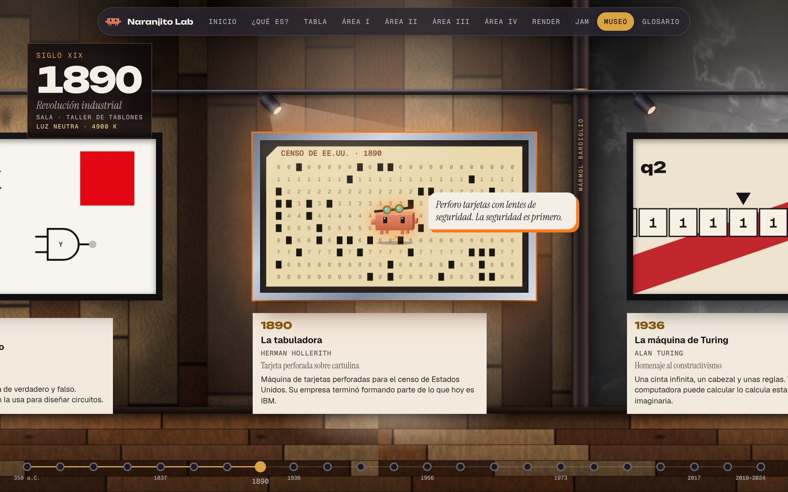 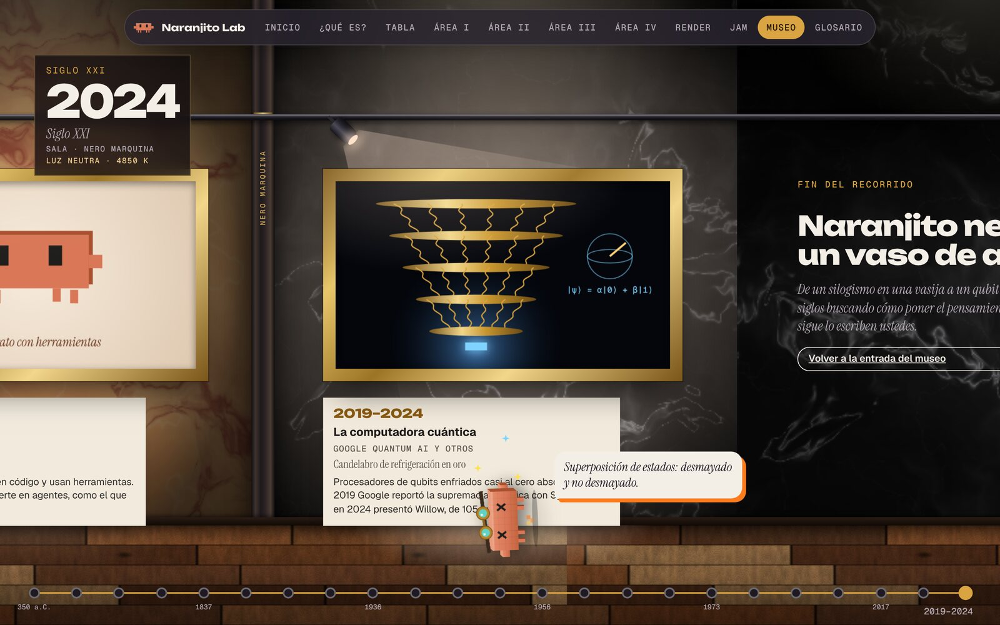

### 8. Glosario sin pena
Doce tarjetas que se voltean: Prompt, Agente, Codex, Claude Code, Artifact, Repositorio, Token, Contexto, Alucinación, Conector (MCP), Subagente y API.

### Secretos
- Prueba el código Konami: <kbd>↑</kbd><kbd>↑</kbd><kbd>↓</kbd><kbd>↓</kbd><kbd>←</kbd><kbd>→</kbd><kbd>←</kbd><kbd>→</kbd><kbd>B</kbd><kbd>A</kbd>
- Escribe `sudo` en cualquier parte
- Al final de la página hay una pastilla roja y una azul

## Cómo abrirlo

**En tu computadora:** descarga el repo y sírvelo con cualquier servidor estático, porque el navegador no deja cargar el modelo del auto desde un archivo abierto con doble clic:

```bash
python3 -m http.server 8000
```

Luego abre `http://localhost:8000` en Chrome, Edge o Firefox. Si abres `index.html` directo, todo funciona menos el auto del estudio 3D.

**En línea con GitHub Pages:** en el repo, entra a **Settings → Pages**, elige la rama `main` y la carpeta `/ (root)`, y guarda. En un par de minutos queda en `https://<tu-usuario>.github.io/<nombre-del-repo>/`.

## Cómo editarlo

El código vive en `src/`, dividido por partes. `index.html` se genera uniéndolas:

```bash
bash src/build.sh
```

```
naranjito-lab/
├── index.html        ← la página completa, generada
├── src/
│   ├── body.html     ← el contenido y las secciones
│   ├── style.css     ← tokens de color por sección y estilos
│   ├── app.js        ← Naranjito, fondos vivos, prototipos, Jam, glosario, tour
│   ├── gallery.js    ← el museo: 23 obras generativas y la línea del tiempo
│   ├── render.js     ← los cuatro shaders de WebGL y la simulación de fluidos del fuego
│   ├── arch.js       ← el estudio 3D con three.js
│   └── build.sh
├── assets/car.glb    ← el auto del estudio 3D (CC BY 4.0)
└── docs/img/         ← capturas de este README
```

## Créditos y avisos

- Hecho con **Claude Code** como demostración de lo que un agente puede construir en una sesión.
- **Naranjito es un homenaje de fan** al bichito pixelado que te saluda al abrir Claude Code. Este proyecto **no es oficial ni está afiliado a Anthropic**.
- Las obras, las paredes y las luces del museo son código que dibuja el navegador, no fotos ni reproducciones. Los textos de Cervantes y Sor Juana son de dominio público.
- Los partidos del simulador electoral son ficticios. Los modelos (SIR, ADN, render) son ilustrativos: no sustituyen datos oficiales, diagnósticos ni asesoría.
- Auto del estudio 3D: **«Car Concept»** de Eric Chadwick (Darmstadt Graphics Group), basado en un modelo de dominio público de Unity Fan, publicado por Khronos Group en [glTF Sample Assets](https://github.com/KhronosGroup/glTF-Sample-Assets/tree/main/Models/CarConcept) bajo licencia [CC BY 4.0](https://creativecommons.org/licenses/by/4.0/). Incluye logos de Khronos, que son marcas de Khronos Group.
- Motor 3D: [three.js](https://threejs.org) r147, licencia MIT, cargado desde jsDelivr.
- La casa, el yate, los mármoles, las maderas y el fuego están generados con código; no son fotos.
- Tipografías de Google Fonts: Unbounded, Geist, Geist Mono e Instrument Serif.
